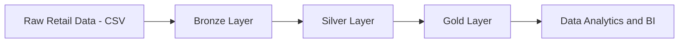

# Retail Data Warehouse Project

## Project Overview

This project demonstrates the end-to-end development of a retail data warehouse using Microsoft SQL Server. Its primary objective is to transform raw retail data into a structured, reliable, and analytics-ready data model that supports business intelligence and data-driven decision-making.

The project implements an ETL (Extract, Transform, Load) pipeline based on the Medallion Architecture, consisting of Bronze, Silver, and Gold layers. It also incorporates stored procedures, dimensional modeling, clustered indexes, and date-based table partitioning to support repeatable data processing and efficient analytical workloads.

## Data Architecture

| Layer | Purpose | Key Operations |
| --- | --- | --- |
| Bronze | Raw data storage | Data ingestion and repeatable loading |
| Silver | Cleansed and standardized data | Data cleansing, standardization, normalization, derived columns |
| Gold | Business-ready data | Dimensional modeling, integration, aggregations, performance optimization |

## ETL Pipeline

### 1. Bronze Layer — Raw Data Ingestion

The Bronze layer serves as the initial landing area for the source retail dataset. Raw data is loaded from CSV files into SQL Server while preserving its original structure as closely as possible.

- Extracted and loaded source data into the Bronze schema.
- Preserved raw data for downstream transformations and traceability.
- Developed stored procedures to automate and standardize repeated data loads.
- Established a repeatable ingestion process for future source data refreshes.

### 2. Silver Layer — Data Cleansing and Transformation

The Silver layer transforms raw Bronze data into consistent and reliable datasets suitable for dimensional modeling.

- **Data Cleansing:** Addressed data quality issues identified in the source dataset.
- **Data Standardization:** Applied consistent formats and representations across datasets.
- **Data Normalization:** Normalized data values where necessary to improve consistency.
- **Derived Columns:** Created additional attributes using business and transformation logic.
- **Data Preparation:** Prepared transformed datasets for integration into the Gold layer.

### 3. Gold Layer — Dimensional Modeling and Business Integration

The Gold layer provides a business-oriented representation of the retail data. SQL views were developed using dimensional modeling principles, organizing data into fact and dimension structures based on a star schema approach.

- **Fact Structures:** Represent measurable business events and transactional data.
- **Dimension Structures:** Provide descriptive attributes for analytical filtering, grouping, and reporting.
- **Data Integration:** Combined related Silver datasets using SQL joins.
- **Business Transformations:** Applied relevant aggregations and business-oriented calculations.
- **Column Organization:** Organized attributes into consistent, readable, and analytics-friendly structures.

The resulting model provides a foundation for sales analysis, customer segmentation, product performance analysis, and business intelligence reporting.

## ETL Automation

Stored procedures were implemented to encapsulate data loading and processing logic, reducing manual intervention and improving the repeatability of the ETL workflow.

These procedures support consistent execution of data refresh operations when new source data becomes available. They provide a foundation for future scheduled ETL execution.

## Performance Optimization

### Clustered Indexes

Clustered indexes were created on selected physical tables using unique key columns to support efficient data access and key-based queries.

### Table Partitioning

Given the volume of transactional data, date-based partitioning was implemented on the physical sales fact table using the order date column.

The partitioning strategy was designed to:

- Support partition elimination for suitable date-filtered queries.
- Improve the manageability of large transactional tables.
- Facilitate time-based data maintenance and analytical workloads.

Indexing and partitioning were applied to physical tables rather than ordinary SQL views. Actual query performance benefits depend on query patterns and execution plans.

## Technologies and Concepts

| Technology / Concept | Application |
| --- | --- |
| Microsoft SQL Server | Data warehouse platform |
| T-SQL | Data loading, transformation, integration, and modeling |
| CSV | Source data format |
| Medallion Architecture | Bronze, Silver, and Gold layer organization |
| ETL | Extract, Transform, and Load workflow |
| Stored Procedures | Repeatable data processing |
| Star Schema | Dimensional data modeling |
| SQL Views | Business-ready data presentation |
| Clustered Indexes | Physical data access optimization |
| Table Partitioning | Date-based management of large tables |

## Data Quality Considerations

Data quality was considered throughout the transformation process. Source data was reviewed and cleansed before being exposed through the Gold layer. Any unresolved source inconsistencies should be documented and considered when interpreting downstream analytical results.

## Project Outcomes

- Developed a multi-layer retail data warehouse from raw source data.
- Implemented a repeatable ETL workflow using SQL Server and stored procedures.
- Transformed raw datasets into cleansed and standardized data structures.
- Designed business-ready fact and dimension structures using star schema principles.
- Applied clustered indexing and date-based partitioning to selected physical tables.
- Established an analytics-ready data foundation for downstream reporting and business intelligence.

## Downstream Analytics

This data warehouse serves as the data foundation for a separate Retail Data Analytics project, where the prepared data is used to explore business performance and generate analytical insights through SQL.

The Gold layer can also be connected directly to business intelligence tools such as Microsoft Power BI for dashboard development and reporting.

---

This project was developed as a hands-on portfolio project to demonstrate practical skills in SQL Server, data engineering, ETL development, dimensional modeling, and analytical data preparation.
